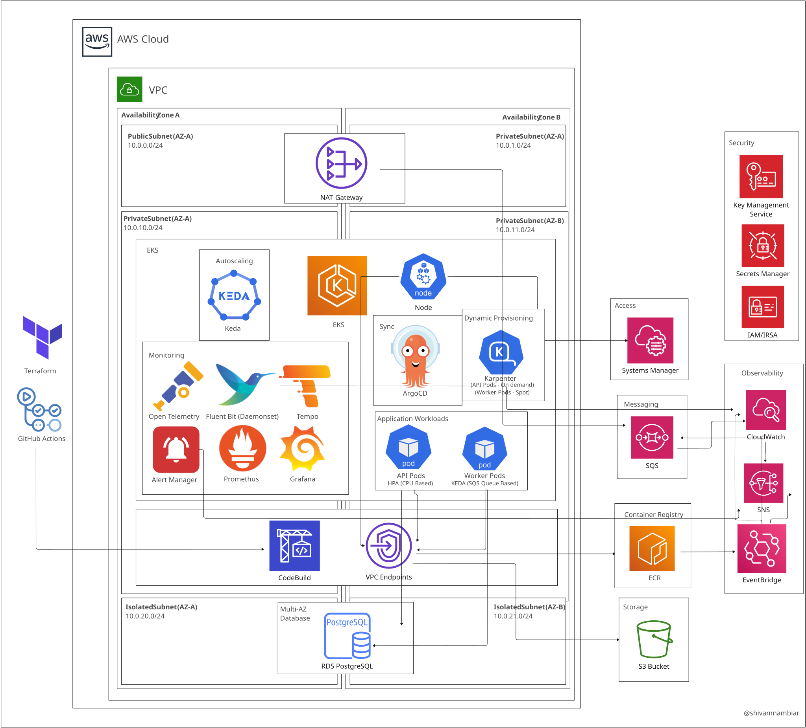

# Sales Pipeline

<p align="center">A fully private, GitOps-deployed batch ingestion pipeline on AWS EKS. The application is deliberately small; the infrastructure — two Terraform stacks, a network-isolated cluster, pull-based deploys, and a separate least-privilege identity for every workload — is the product.</p>

<p align="center">
  <a href="#status">Status</a> •
  <a href="#what-this-demonstrates">What This Demonstrates</a> •
  <a href="#how-it-works">How It Works</a> •
  <a href="#infrastructure-decisions">Infrastructure Decisions</a> •
  <a href="#repository-structure">Repository Structure</a> •
  <a href="#deployment">Deployment</a> •
  <a href="#cicd">CI/CD</a> •
  <a href="#local-development">Local Development</a> •
  <a href="#what-id-improve-in-production">What I'd Improve</a> •
  <a href="#license">License</a>
</p>

---
<p align="center">
  
</p>
---

## Status

Nothing in this repository has been applied to an AWS account yet. **The first real `terraform apply` is the next milestone**, and `preflight.txt` records the pre-apply review that has to be cleared first. What has been checked: `terraform fmt -check` and `terraform validate` pass on both stacks; `kustomize build` renders the prod overlay's 26 resources, and the manifest gate stops, as designed, at the twelve `REPLACE_` placeholders in the render — nine infra values that bootstrap fills and three image tokens that the first deploy pins (so CI's manifest job stays red until both have landed); the three test suites run in CI's test job with moto standing in for AWS; `smoke.sh` and the memory plateau test were run locally against the compose stack, and their outputs are not committed. Numbers below that would come from a live cluster, such as the in-cluster calibration load test, are planned rather than measured.

---

## What This Demonstrates

| Skill Area | What's Implemented |
|---|---|
| Private-by-default architecture | No load balancer, no Ingress, no public EKS endpoint, RDS in subnets with only the VPC-local route. Humans reach the cluster through an SSM port-forward tunnel; CI reaches it through an in-VPC CodeBuild project; deploys are pull-based because nothing outside the VPC can push |
| Infrastructure as Code | Two Terraform root stacks with separate S3 state keys (native lockfile locking, no DynamoDB): an infra stack of six modules (`kms`, `network`, `security`, `data`, `cicd`, `cluster`) and a platform stack of eight pinned Helm releases that can only be planned once the cluster exists |
| GitOps delivery | CI tests, builds, Trivy-scans, pushes images tagged with the git SHA, pins that tag into the kustomize overlay and commits it back; Argo CD (automated sync, prune, self-heal) converges the cluster. CI never runs `kubectl apply` |
| CI/CD | Three GitHub Actions workflows. The two that touch AWS authenticate via OIDC to separate roles whose trust is scoped to that workflow file (`job_workflow_ref`); the third needs no cloud credentials. A `production` environment gate on every apply and deploy, PR plan comments and artifacts, and a shared manifest gate that rejects mutable tags, digests and unresolved placeholders |
| Kubernetes platform | EKS 1.36 with Karpenter (on-demand pool for the API, Spot pool for the worker), KEDA scale-to-zero on SQS depth, a CPU HPA, PodDisruptionBudgets for both workloads, a soft zone-spread constraint on the API, `restricted` Pod Security Standards and default-deny NetworkPolicy enforced by the VPC CNI |
| Security | IRSA role per workload with statement-level least privilege, IAM database authentication (no application passwords anywhere), one customer-managed KMS key across S3/SQS/RDS/ECR/SNS/logs/EKS secrets, immutable ECR tags, IMDSv2 with hop limit 1, and an explicit IAM deny on CodeBuild buildspec overrides |
| Observability | Prometheus + Alertmanager (seven application alert rules routed to SNS over IRSA/SigV4), Grafana with Tempo as a datasource, OpenTelemetry auto-instrumentation into Tempo, Fluent Bit shipping pod logs to a KMS-encrypted CloudWatch group, a CloudWatch alarm on the dead-letter queue, ECR scan findings alerting through EventBridge |
| Data pipeline design | Claim-check pattern (payload in S3, two-field pointer in SQS), idempotent result writes (`INSERT … ON CONFLICT DO NOTHING`), a dead-letter queue with its own alarm, graceful SIGTERM handling, and declarative cleanup through S3 lifecycle rules |
| Capacity engineering | Batch and object limits set just below the out-of-memory points found in local load tests, container memory limits from a sustained plateau test against the compose stack (local runs; the logs are not committed), and a stdlib-only load generator with stop rules for the in-cluster calibration run |
| Operations | A lifecycle runbook from empty account to teardown, bootstrap scripts with fail-closed preflights, a documented teardown order that avoids orphaned Spot nodes, and a design record that keeps settled decisions from being reopened |

---

## Built With

[]()
[]()
[]()
[]()
[]()
[]()
[]()
[]()
[]()
[]()
[]()
[]()

<details>
<summary><strong>Pinned versions</strong></summary>

| Component | Version | Where |
|---|---|---|
| Terraform | 1.16.1 in CI and CodeBuild; `required_version >= 1.10` for native S3 locking | `terraform.yml`, `buildspec.yml`; `versions.tf` (infra stack), `versions_platform_stack.tf` (platform stack) |
| Providers | aws `~> 5.0` (locked 5.100.0); helm `~> 2.13` (locked 2.17.0); kubernetes `~> 2.30` (locked 2.38.0) | constraints in each stack's `versions*.tf`; locks in `.terraform.lock.hcl` (aws in both stacks, helm and kubernetes in the platform stack's) |
| EKS | 1.36; addons vpc-cni v1.22.1, CoreDNS v1.14.3, kube-proxy v1.36.0 (all `eksbuild`-pinned) | `modules/cluster` |
| Karpenter | chart 1.14.1 | `modules/platform` |
| KEDA | chart 2.20.2 | `modules/platform` |
| kube-prometheus-stack | chart 88.6.1 | `modules/platform` |
| Tempo | chart 2.2.3 | `modules/platform` |
| Argo CD | chart 10.4.0 | `modules/platform` |
| OpenTelemetry operator | chart 0.112.0 | `modules/platform` |
| aws-for-fluent-bit | chart 0.2.0 | `modules/platform` |
| metrics-server | chart 3.13.0 | `modules/platform` |
| kustomize / kubeconform | v5.4.3 / v0.6.7, validating `-strict` against Kubernetes 1.36.0 schemas and a CRD catalog pinned to one commit | `scripts/validate-manifests.sh`, both workflows that run it |
| Trivy action | 0.28.0, the one action pinned to an exact version | `app.yml` |
| Python / PostgreSQL | 3.12-slim images / 16 | Dockerfiles, `modules/data` |

</details>

---

## How It Works

### The request path

The API does no processing. A `POST /jobs` body is a JSON object with a `records` list of 1 to 50,000 objects, each with optional `region`, `amount`, `sale_date` and `order_id` fields. The API checks only shape — list bounds, string lengths, finite floats — then, in this order:

1. writes the normalised batch to S3 as `raw/<job_id>.json`;
2. inserts a `jobs` row with status `pending`;
3. sends a two-field pointer message, `{"job_id": …, "s3_key": …}`, to SQS;
4. returns `202 Accepted` with the job ID.

Each step fails closed. An S3 failure returns 502 before any row exists; a database failure returns 500 and leaves the S3 object for the 30-day lifecycle rule to expire; an enqueue failure returns 502 and marks the row `failed` so the database does not carry a `pending` job that nothing will process. That last update is best-effort: if it fails too, or the process dies between the insert and the send, a `pending` row with no message is left behind, and nothing sweeps those yet. Semantic validation (negative amounts, unparseable dates, duplicates) is deliberately left to the worker: the synthetic data mixes in malformed rows on purpose so the processing stage has real bad data to reject.

A middleware guards the body before parsing: a POST without `Content-Length` gets a 411, a malformed one a 400, and anything above 10 MiB a 413.

| Method | Path | Returns |
|---|---|---|
| `POST` | `/jobs` | `202` `{job_id, status}` — or `422` for an empty/oversized list, NaN, or over-long strings |
| `GET` | `/jobs/{job_id}` | `{job_id, status, submitted_at, completed_at}`; status is `pending`, `done` or `failed`; `404` for an unknown job, `422` for a non-UUID id |
| `GET` | `/jobs/{job_id}/result` | `{job_id, total_sales, rows_processed, rows_rejected}`; `404` until the worker has written a result — a job marked `failed` does not get one, so poll the status endpoint |
| `GET` | `/healthz` | always `{"status":"ok"}` — the liveness probe, dependency-free by design |
| `GET` | `/readyz` | `SELECT 1`, `GetQueueAttributes` and `HeadBucket`; `503` if any fails — the readiness probe |
| `GET` | `/metrics` | Prometheus exposition from `prometheus-fastapi-instrumentator` |

### The worker

The worker long-polls SQS one message at a time with 20-second waits, then makes a three-way decision about every message:

- **Unverifiable messages are left for the dead-letter queue.** The body must be JSON with a string `job_id` that parses as a UUID and an `s3_key` exactly equal to `raw/<job_id>.json`. Anything else is left undeleted so SQS redelivers it and, after three receives, moves it to the DLQ. A forged key is never fetched.
- **Verifiable but unprocessable input is failed and deleted.** A `HEAD` request checks `ContentLength` against the 15 MiB cap before anything is downloaded; an oversized object, or a payload whose `records` is not a list, marks the job `failed` and deletes the message, because that is bad input rather than a poison loop.
- **Everything else is processed, and an unexpected exception is treated as transient.** If the fetch, decode, processing or database write raises, the worker counts a `failed` outcome, leaves the message for redelivery and leaves the job `pending`; the DLQ alarm is the backstop if it keeps failing. Receive errors back off from 1 to 30 seconds and the backoff still honours shutdown.

The processing itself is pure Python: `process_batch` in `worker/processing.py` imports only `math` and `datetime`, performs no I/O, and never raises on anything the API can hand it, which is what lets its unit tests run with no mocks. Results are written with `INSERT INTO results … ON CONFLICT (job_id) DO NOTHING`, and the job flips to `done` in the same transaction only when that insert actually inserted. A redelivered message finds the row already there, increments a `redelivery_skipped` counter and is deleted without double counting.

On SIGTERM the worker sets a flag and finishes the in-flight message before exiting, inside the pod's 60-second grace period. If it is killed outright instead, the message was never deleted, SQS redelivers it, and idempotency makes that safe. The two behaviours cover for each other, and together they are what make the worker safe to run on Spot. Metrics on port 9100 cover jobs by outcome (`processed`, `redelivery_skipped`, `failed`), records by outcome, rejections by reason, and a processing-time histogram.

### Processing rules

Within a batch, each element is checked in order and rejected with the first reason that applies: `not_an_object`, `invalid_order_id_type`, `duplicate_order_id`, `missing_region`, `invalid_region_type`, `missing_amount`, `non_numeric_amount`, `non_finite_amount`, `non_positive_amount`, `missing_date`, `unparseable_date`. Five of those eleven can only fire on an object the API did not write, because the API already enforces types and finite numbers; the worker checks them anyway because it treats the S3 object as untrusted input, even though the API's role is the only workload identity granted `s3:PutObject` on `raw/*` (the bucket policy itself does not restrict writers). Valid records are summed per region. Duplicate detection is per batch, and an `order_id` is only remembered once its record passes validation. What is persisted is the grand total plus the two counts; the rejection breakdown reaches the logs and the `worker_records_rejected_total{reason}` counter, and the per-region totals are summed into `total_sales` and otherwise discarded.

---

## Infrastructure Decisions

### Everything is private — the defining decision

There is no public load balancer, no Ingress controller, no public cluster endpoint and no public RDS. The EKS API endpoint has private access only (`eks_public_endpoint = false`; a public endpoint exists in the code purely as an IAM-and-RBAC-gated escape hatch). Humans reach the control plane through an SSM Session Manager port-forward to a node — every node role carries `AmazonSSMManagedInstanceCore` for exactly this — and reach the API with `kubectl port-forward` to its ClusterIP Service. That access is gated by IAM (an EKS access entry for the operator principal, created only when one is supplied) plus Kubernetes authorization, which the operator holds as cluster admin through that entry's `AmazonEKSClusterAdminPolicy` association; nothing is exposed to the internet. This is accurately described as a private, network-isolated backend, not "Zero Trust": Zero Trust verifies identity per request rather than trusting network position.

This one choice explains the strangest-looking parts of the design:

- **The platform Terraform runs inside the VPC.** Installing Karpenter, KEDA, Argo CD and the monitoring stack means talking to the cluster API, which only exists inside the VPC. So the platform stack is planned and applied by a CodeBuild project in the private subnets: GitHub Actions uploads the source zip, starts the build, and streams its log live into the Actions console. The cluster security group admits that project's security group on 443, alongside the EKS module's own default rule for the nodes, and nothing else; the project's own group is egress-only. Its IAM role is cluster admin inside Kubernetes (it installs the Helm layer) but holds only six AWS statements — its log group, VPC networking (ENI create/describe/delete, with `CreateNetworkInterfacePermission` conditioned to the private subnets), the state bucket, `eks:DescribeCluster` on the one cluster, and the Grafana secret — and no KMS grant at all.
- **Deploys are pull-based.** GitHub-hosted runners cannot reach the cluster to apply anything, so Argo CD runs inside the cluster and pulls from the repository instead. For application deploys, CI's only cluster-facing action is to ask a second, minimal CodeBuild project to run `kubectl annotate … refresh=hard` so the sync happens immediately instead of on the next three-minute poll. That project has a four-statement IAM role and a Kubernetes group bound to `get` and `patch` on Applications in one namespace. The platform apply above is the one CI path that writes to the cluster as cluster admin; the only other CI write is that refresher's annotate.
- **The NAT gateway is permanent.** The original ambition was no NAT at all, using VPC interface endpoints instead. Reality won: Argo CD needs GitHub, Karpenter talks to the IAM API, and platform images come from public registries — this VPC has endpoints for none of them, and GitHub and the public registries cannot have one. The endpoints kept are the three where the per-GB arithmetic actually pays: the free S3 gateway endpoint and the two ECR interface endpoints that keep image-pull volume off the NAT. Everything else (STS, SQS, CloudWatch Logs, Secrets Manager, GitHub, chart repositories) rides the NAT.

### Two Terraform stacks, not one

The infra stack (`terraform/`) and the platform stack (`terraform/platform-stack/`) are separate root modules with separate state keys, `terraform.tfstate` and `platform.tfstate`, in the same bucket. The split exists because the `helm` and `kubernetes` providers must be configured from a cluster that already exists; configuring them from `module.cluster` outputs inside a single apply is the classic provider-bootstrap deadlock. The platform stack instead reads the live cluster through `data.aws_eks_cluster`, authenticates with `exec: aws eks get-token` (short-lived tokens as the CodeBuild role, no static kubeconfig), and reads the infra outputs it needs — the IRSA role ARNs for Fluent Bit, Karpenter, KEDA and Alertmanager, the cluster endpoint, the Karpenter interruption queue, the pod-log group and the SNS topic — from the infra stack's remote state. The cluster name, region, state bucket and Prometheus retention are variables, and the Grafana admin password reaches the build from Secrets Manager.

The state keys are a contract, not a preference: the platform stack hard-codes the infra key, so a custom key would either fail the platform plan or silently create a second empty state that collides on globally named resources.

### Six modules and why KMS is its own

Terraform derives the order from the references; one apply sequences it:

1. **`kms`** — one customer-managed key with rotation enabled, a 7-day deletion window and the alias `alias/sales-pipeline`. It is split out of `security` so it has no dependency on the cluster; that is what breaks the `cluster ↔ security` cycle (`security` needs the cluster's OIDC provider, the cluster needs the key). The key policy has five statements: account-root administration; the six data-plane services (RDS, SQS, S3, Secrets Manager, ECR, SNS) may use the key only through `kms:ViaService` conditions for the deployment region; CloudWatch Logs only with a log-group encryption context; CloudWatch and EventBridge get the decrypt/generate pair they need to publish to the KMS-encrypted SNS topic; and EKS gets unconditional use for envelope-encrypting Kubernetes secrets.
2. **`network`** — VPC, three subnet tiers across two AZs, one NAT, VPC endpoints, flow logs.
3. **`data`** — the stateful layer: S3, SQS + DLQ, RDS, ECR, the SNS topic and its EventBridge rules, log groups, the DLQ alarm.
4. **`cicd`** — the two in-VPC CodeBuild projects, their IAM roles and shared security group.
5. **`cluster`** — EKS, node groups, addons, Karpenter IAM, access entries.
6. **`security`** — the five IRSA roles, trusted by the cluster's OIDC provider.

`modules/platform` (the Helm releases) is loaded only by the platform stack, never by the infra stack.

### Network: three tiers, one NAT, three endpoints

The VPC is `10.0.0.0/16` across two availability zones, carved into `/24`s. Public subnets (`10.0.0.0/24`, `10.0.1.0/24`) hold only the NAT gateway. Private subnets (`10.0.10.0/24`, `10.0.11.0/24`) hold the EKS control-plane ENIs, every node, both CodeBuild projects and the interface endpoints. Isolated subnets (`10.0.20.0/24`, `10.0.21.0/24`) hold RDS and have only the VPC-local route: no default route to the NAT or the internet gateway, and no S3 gateway-endpoint route, which is attached to the private route tables alone. The ECR interface endpoints sit in the private subnets behind a security group that admits HTTPS only from the private-subnet CIDRs, so the isolated tier cannot use them either; the private tier reaches RDS over the local route, admitted by the database security group on 5432. The private subnets carry the `karpenter.sh/discovery` tag that the EC2NodeClass selects on; the isolated ones do not, so Karpenter can never place a node next to the database.

`single_nat = true` is a deliberate cost choice (one NAT in the first AZ, a one-AZ risk), and the per-AZ private route tables are kept so one-NAT-per-AZ is a flag flip, not a rewrite. VPC flow logs capture `ALL` traffic into a KMS-encrypted CloudWatch group with 14-day retention; that KMS-grant-plus-log-group pattern is reused for every other log group in the project.

### S3 + SQS + Postgres: the large-payload pattern and what it costs

Payloads live in S3 rather than in the queue because queue messages have small size limits; the message is a pointer. The choices around it are tradeoffs, not defaults:

- **SQS over Postgres-as-a-queue.** Every option has a bill: Postgres charges polling, locking and cleanup code; SQS charges idempotency. Idempotency is the smaller fixed cost and is needed anyway because SQS delivery is at-least-once, and Postgres's atomicity advantage only holds for a single-database pipeline, which this outgrows the moment it fans out to S3.
- **A standard queue, not FIFO.** Redelivery is tolerated by design instead of being prevented: the worker's `ON CONFLICT DO NOTHING` write makes a duplicate delivery a no-op. The visibility timeout is 300 seconds, set above worst-case batch processing time; messages are retained 4 days; after 3 receives they redrive to a dead-letter queue retained for 14 days. Both queues are KMS-encrypted and deny non-TLS access.
- **The DLQ has its own alarm.** `ApproximateNumberOfMessagesVisible > 0` on the DLQ pages the SNS topic, because a batch that crashes or OOMs the worker lands there silently — especially after KEDA has scaled the worker to zero.
- **Cleanup is declarative.** The raw bucket expires objects under `raw/` after 30 days, with versioning deliberately suspended so expiry actually deletes bytes; the worker deletes each message once it has been handled, and SQS moves what it cannot handle to the DLQ. There is no hand-written cleanup job to maintain. The bucket is KMS-encrypted with S3 Bucket Keys, blocks all public access, denies non-TLS requests, and is named with the account ID for global uniqueness.

### RDS: IAM authentication, no application passwords

PostgreSQL 16 on `db.t4g.medium`, Multi-AZ, gp3 storage autoscaling from 20 to 100 GiB, 7-day automated backups, Performance Insights, and `postgresql` logs exported to a log group Terraform creates first so that it is KMS-encrypted rather than auto-created unencrypted. Storage and Performance Insights are encrypted with the same project key. The engine version is pinned to the major only, so RDS picks a supported minor at create time instead of failing on a deprecated one. The security group admits port 5432 only from the private-subnet CIDRs. Deletion protection is off and no final snapshot is taken: a deliberate demo choice so teardown is clean, and the first thing to flip for real data.

Nobody holds an application database password. IAM database authentication is on, and each workload connects as its own `rds_iam` user — `app_api` and `app_worker` — minting a fresh IAM token on every new connection through a SQLAlchemy `do_connect` hook, over `sslmode=require`. The one password that must exist, the master user's for bootstrap and break-glass, is generated and held by RDS itself in Secrets Manager (`manage_master_user_password`), encrypted with the project key; only the secret's ARN appears in Terraform state, never the value. Granting `rds_iam` to the master would disable its password login and lose break-glass access, which is why the per-workload users exist at all. They are created once by `scripts/db-bootstrap.sql` from a `psql` pod inside the VPC: `app_api` alone gets `CREATE` on the schema because the API creates its tables at startup, and default privileges then grant `app_worker` access to whatever `app_api` creates — which on PostgreSQL 16 first requires making the master a member of `app_api`, the kind of detail the script records because it cost time to learn. The SQL is not idempotent — the runner feeds it to `psql` with `ON_ERROR_STOP`, so a re-run stops at the first `CREATE USER` — and the runner's `--verify-only` mode re-checks the grants.

### EKS: a private endpoint, tainted node groups, and Karpenter for everything else

The cluster is built with the community `terraform-aws-modules/eks` module (`~> 20.0`) on Kubernetes 1.36 with all five control-plane log types enabled (90-day, KMS-encrypted) and Kubernetes secrets envelope-encrypted with the project key. The three managed addons are version-pinned, and the VPC CNI is installed `before_compute` with `enableNetworkPolicy = true`, which is what makes the application's NetworkPolicies actually enforced.

Two managed node groups exist, both tainted so that no application pod can land on them: `bootstrap` (3 × `c5.xlarge`, hosting Karpenter, KEDA, metrics-server, the OpenTelemetry operator, CoreDNS and every Argo CD component) and `monitoring` (1 × `c5.xlarge`, hosting Prometheus, Alertmanager, Grafana, the Prometheus operator, kube-state-metrics, Tempo and the OTel collector). Application pods only ever run on nodes Karpenter provisions. Both node groups require IMDSv2 with a hop limit of 1, and the NetworkPolicy additionally blocks pod egress to `169.254.169.254`. The monitoring tier being one fixed node with no persistent volumes configured is a demo-sized trade-off, recorded under "What I'd Improve".

**Karpenter, not Cluster Autoscaler,** across two NodePools sharing one AL2023 EC2NodeClass (IMDSv2 required, subnets and security groups discovered by tag):

| NodePool | Capacity | Who lands here | Limits | Disruption |
|---|---|---|---|---|
| `on-demand` | On-Demand, amd64, t/m/c/r families, generation > 2 | the API (`nodeSelector: capacity=on-demand`) | 16 vCPU | consolidate when empty or underutilised after 1m; 10% of nodes at a time |
| `spot` | Spot, same instance constraints, tainted `capacity-spot=true:NoSchedule` | the worker (`nodeSelector` + matching toleration) | 32 vCPU | same policy |

The worker is safe on Spot specifically because it is idempotent and SQS redelivers on interruption: a reclaim mid-job just triggers a redelivery, not a lost or duplicated result. Karpenter's interruption queue, created by the same EKS submodule that creates its IAM and wired in through `settings.interruptionQueue`, delivers Spot interruption notices, which Karpenter answers by cordoning and draining the node, and the worker's SIGTERM handling finishes the message in hand. The API stays On-Demand for predictable request serving. The AMI alias is deliberately unpinned (`al2023@latest`); drift replacement is bounded by a NodePool budget that permits `Drifted` rotations only between 03:00 and 04:00 UTC. Cluster access is through EKS access entries: the CI role that creates the cluster becomes admin, a human operator principal gets an admin entry, the platform CodeBuild role gets admin (it installs the Helm layer), and the Argo CD refresher role gets only a Kubernetes group bound to `get` and `patch` on Applications in the `argocd` namespace.

### Autoscaling: two honest signals, never both on one workload

- **The worker scales 0 → 20 on SQS queue depth** through KEDA (target 5 messages per replica, 120-second cooldown). The worker is I/O-bound, so CPU would lie about real demand; queue depth is the honest signal, and scale-to-zero is the cost lever when the queue is empty. KEDA authenticates with its own IRSA role (`sqs:GetQueueAttributes` only): the TriggerAuthentication's `podIdentity.provider: aws` makes KEDA present the operator pod's own credentials rather than assuming the worker's, and because the operator polls the queue itself it can scale the worker from zero when no worker pod exists.
- **The API scales 3 → 10 on 70% CPU** through a standard HPA backed by metrics-server, the honest signal for a request-serving web service.
- **Argo CD ignores `spec.replicas` on both Deployments** (`RespectIgnoreDifferences`), so self-heal never fights the autoscalers.

### Availability: three settings that have to agree

The goal is to never serve on fewer than two API pods and to bring up a replacement before removing an old one. That takes three settings governing three different events: the rolling-update strategy (`maxUnavailable: 0`, `maxSurge: 1`) for image rollouts; the PodDisruptionBudget (`minAvailable: 2`) for node drains and Karpenter consolidation; and the HPA floor (`minReplicas: 3`). The PDB floor must stay strictly below the running count, or drains deadlock and Karpenter can evict nothing. The worker's PDB is `maxUnavailable: 1` rather than a floor, because a floor would fight scale-to-zero. API pods also spread across zones (`maxSkew: 1`, `ScheduleAnyway`), and liveness and readiness are split so a database blip pulls a pod from rotation without a restart storm. The worker carries no probes at all; a hung consumer surfaces through queue depth and the alert rules rather than a kubelet restart.

### Security posture

**One AWS identity per workload (IRSA).** Each trust policy checks both the OIDC audience and an exact `namespace:serviceaccount` subject (Alertmanager's lists two subjects, to cover either name the chart may give its service account).

| Role | Allowed to |
|---|---|
| `api` | `s3:PutObject` on `raw/*`, `s3:ListBucket` (readiness), `sqs:SendMessage` + `GetQueueAttributes` on the jobs queue, `rds-db:connect` as `app_api` |
| `worker` | `s3:GetObject` on `raw/*`, `sqs:ReceiveMessage` + `DeleteMessage` + `GetQueueAttributes`, `rds-db:connect` as `app_worker` |
| KEDA operator | `sqs:GetQueueAttributes` on the jobs queue |
| Alertmanager | `sns:Publish` on the alerts topic |
| Fluent Bit | `logs:CreateLogStream` + `PutLogEvents` on the pod-logs group |

The API cannot read batches, the worker cannot write them, and neither can touch the DLQ or the master credentials. The API and worker roles also carry a `kms:Decrypt` + `kms:GenerateDataKey` statement on the project key for SSE-KMS (the worker's `GenerateDataKey` is broader than a read-only consumer strictly needs), Alertmanager a slightly wider `kms:GenerateDataKey*`; KEDA and Fluent Bit carry no KMS statement. One more IRSA identity lives outside this module: the Karpenter controller's role, created by the EKS module's Karpenter submodule, which holds the scoped EC2, instance-profile, `iam:PassRole`, SSM and pricing read, and interruption-queue permissions that provisioning nodes requires.

**Hardened workloads.** The `sales-pipeline` namespace enforces the `restricted` Pod Security Standard. Both Deployments run as UID 1000 with `runAsNonRoot`, `seccompProfile: RuntimeDefault`, `allowPrivilegeEscalation: false`, all capabilities dropped and a read-only root filesystem (the one control PSA does not enforce). Neither application writes to disk, so no writable volumes are needed.

**Default-deny network policy.** Ingress and egress are denied namespace-wide, then four things are allowed: Prometheus (the `monitoring` namespace) to the API on 8000 and the worker on 9100, kube-dns on 53, and API/worker egress on 443 (AWS APIs), 5432 (RDS) and 4318 (the OTel collector) with the instance metadata address excluded. API ingress is monitoring-only on purpose: no production in-cluster caller exists (the worker consumes from SQS, not the API), the one non-production caller — the calibration load generator — is deployed into `monitoring` to ride the same allowance, and port-forward traffic arrives through the kubelet path, which NetworkPolicy does not govern and RBAC does.

**Encryption at rest.** The one customer-managed key encrypts the raw bucket, both application queues, RDS storage, Performance Insights and the master secret, both ECR repositories, the SNS topic, every CloudWatch log group the project creates, and the cluster's Kubernetes secrets. Two things are deliberately off the key because the platform CodeBuild role has no KMS grant: the operator-created Terraform state bucket (the backend writes state SSE-S3) and the Grafana admin secret, which has to be created under the AWS-managed Secrets Manager key for that role to read it. Two more sit outside the stack's control: node root volumes, and the Prometheus, Tempo and Grafana data on them, follow the account's EBS default-encryption setting, and the Karpenter interruption queue created by the EKS submodule uses SQS-owned encryption.

**CI identity.** The two AWS-touching workflows assume IAM roles through GitHub OIDC, so no AWS keys exist in GitHub. The trust policies pin the audience, the immutable repository ID, both `sub` formats, and — the part that actually separates the roles — `job_workflow_ref`, so only `terraform.yml` can assume the near-admin Terraform role and only `app.yml` can assume the ECR-push role. Neither an environment condition nor a branch condition could do that: every gated job shares `environment: production`, and a branch pin would break PR plans. On top of that, both role policies carry an explicit deny on any `codebuild:StartBuild` that includes a buildspec override, so a compromised workflow cannot repurpose the in-VPC runner. The Argo CD refresher is a separate CodeBuild project with a four-statement IAM role for the same reason: `StartBuild` is a powerful call, so the project it can start has nothing worth stealing.

### Image supply chain

ECR repositories are `IMMUTABLE` with scan-on-push and KMS encryption. CI tags every image with the commit SHA, Trivy fails the build on fixable CRITICAL or HIGH findings (`ignore-unfixed: true` skips vulnerabilities with no upstream fix) *before* the push, and because a tag can never be overwritten, what runs in the cluster is provably the exact artifact that was scanned even though the reference is a tag rather than a digest. The manifest gate enforces the other half: it rejects `latest`/`main`/`master`/`stable`, rejects `@sha256:` digests (a digest pin would quietly bypass the tag-immutability guarantee the pipeline is built around), rejects untagged images, and rejects any leftover `REPLACE_` placeholder. New scan findings on pushed images fire two EventBridge rules (CRITICAL > 0, HIGH > 0) into the SNS topic and a CloudWatch log trail.

### Argo CD: how the sync converges

One Application watches `k8s/overlays/prod` on `main` with automated sync, prune and self-heal. The details are what make the first sync land and later ones stay calm: `CreateNamespace=false` (the application namespace ships inside the render with its Pod Security labels, at sync-wave −1 alongside the OpenTelemetry Instrumentation so both exist before the Deployments); `PruneLast=true`; `RespectIgnoreDifferences=true` with `spec.replicas` ignored on both Deployments so the HPA and KEDA own replica counts; a five-attempt exponential retry (10 s, doubling, capped at 3 minutes); and the cascade finalizer, so deleting the Application also deletes the Karpenter NodePools — the reason the documented teardown deletes the Application first, while Karpenter is still running to drain them. The overlay's `app-config` ConfigMap is hash-suffixed, so a configuration change rolls both Deployments through the same sync.

### Observability: three pillars, deliberately split

- **Metrics** are exposed by the services themselves and scraped by the in-cluster `kube-prometheus-stack` through PodMonitors that live in `monitoring` and select the `sales-pipeline` namespace explicitly (an omitted namespace selector would silently scrape nothing). Alertmanager routes to the SNS topic over IRSA + SigV4, with `Watchdog` and `severity: info` black-holed. The scrapes that cannot succeed on this cluster (the managed scheduler, controller-manager and etcd, plus kube-proxy) are disabled rather than left to fail.
- **Traces** come from OpenTelemetry auto-instrumentation — nothing in the application code — injected by annotation and pinned to traces only (`OTEL_METRICS_EXPORTER` and `OTEL_LOGS_EXPORTER` are `none`, so metrics and logs are not duplicated over OTLP). Spans go OTLP/HTTP to a single-replica collector on the monitoring node, are batched and memory-limited, and are forwarded over gRPC to Tempo, which Grafana reads as a datasource next to the metrics. X-Ray was considered and skipped: it would take a collector exporter, an X-Ray ID generator on the Instrumentation CR and an IRSA role for the collector — still no application change — but two trace backends for the same spans is redundant.
- **Logs** go to CloudWatch through a Fluent Bit DaemonSet with its own IRSA role into a Terraform-owned, KMS-encrypted group (`autoCreateGroup: false`), deliberately not Loki: CloudWatch is managed, and it reuses the KMS grant and log-group pattern already established for flow logs. Both services emit JSON lines, and every line about a parsed job carries a `job_id`, which is enough to follow one batch across API, worker and database.

| Alert | Fires when | Severity |
|---|---|---|
| `WorkerJobFailures` | any job failed in the last 10m | warning |
| `HighRecordRejectionRate` | > 20% of records rejected for 10m | warning |
| `WorkerProcessingSlow` | p95 batch processing > 10s for 10m | warning |
| `APIHighErrorRate` | > 5% 5xx for 5m, probe and metrics handlers excluded | critical |
| `APIUnavailable` | zero available API replicas for 5m | critical |
| `APIDown` / `APIScrapeMissing` | scrape target down 2m / absent 10m | critical |
| DLQ alarm (CloudWatch) | any message visible on the dead-letter queue | the one worker-failure signal that survives scale-to-zero |

One SNS topic carries all of it — the Prometheus alerts, the DLQ alarm and the ECR scan findings — to one optional email subscription. Cluster-native where it unifies in Grafana, AWS-managed where it plugs into the existing IAM/KMS posture: the right tool per concern.

### Configuration: one home per value

There is no `terraform.tfvars`, on purpose. Four values come only from CI — the region (a repository variable), the operator principal ARN, the state bucket and the alert email (secrets) — and every other variable is a default in `variables.tf`: the architectural values (`name`, `vpc_cidr`, `az_count`, `enable_nat`, `single_nat`), the namespace, and the public-endpoint escape hatch, off by default. `region` and `tf_state_bucket` have no default, so a local run without them fails loudly rather than silently targeting the wrong region. The Grafana admin password never touches GitHub: the platform CodeBuild project resolves it from Secrets Manager at build start, and the stack refuses an empty value rather than shipping a passwordless Grafana.

On the Kubernetes side, `k8s/overlays/prod/kustomization.yaml` is the single source of every environment-specific value the rendered manifests need; the one value outside it is the Argo CD Application's `repoURL`. The overlay's `configMapGenerator` literals, JSON6902 patches and kustomize `replacements` fan the values out into the base manifests and into CRD fields that generators cannot reach (the KEDA ScaledObject's queue URL and region, the EC2NodeClass's role and discovery tags). A second generator, `infra-values`, is marked local-config so it feeds those replacements at render time and never becomes a ConfigMap in the cluster. The base files hold only `REPLACE_` tokens that the overlay overrides at render time; the overlay's nine infra tokens are filled once from Terraform outputs by `scripts/bootstrap-overlay.sh`, which edits only the overlay and the Application, and the image tags are pinned by CI on every deploy.

### The limits are measured, not guessed

The API's 50,000-records-per-batch cap and the worker's 15 MiB object cap come from load-testing both services locally to their actual out-of-memory points and setting the guards below them. The container memory limits come from a second, sustained test, `loadtest/plateau_test.py`, run against the compose stack: random batches of 10,000, 20,000, 30,000, 40,000 or 50,000 records with 64-character regions and 56-to-60-character order IDs, up to 200,000 records in flight against one API container, until memory set no new peak for five minutes. It peaked at 446 MiB for the API and 106 MiB for the worker (local runs; the logs are not committed); the 1Gi and 512Mi limits sit above that with headroom that also has to cover the OpenTelemetry auto-instrumentation compose does not run. CPU (1 core API, 500m worker) is a judgment call, not a measurement, and requests equal limits on both application containers. Changing any of these means re-running the test under real load.

---

## Repository Structure

```
.
├── .github/
│   ├── workflows/
│   │   ├── app.yml                  # test → build → Trivy → push :sha → pin tag in overlay → Argo CD refresh
│   │   ├── terraform.yml            # fmt/validate/plan on PR; apply, then platform plan+apply via in-VPC CodeBuild
│   │   └── k8s-validate.yml         # manifest gate + shellcheck on every PR and push to main, no AWS
│   └── CICD_SETUP.md                # secrets, variables, the production environment, the two OIDC roles
├── api/
│   ├── main.py                      # FastAPI: POST /jobs, status, result, probes, /metrics, IAM DB auth
│   ├── smoke_test.py                # moto + sqlite; the exact test CI runs
│   └── Dockerfile.api               # python:3.12-slim, non-root, uvicorn on 8000
├── worker/
│   ├── worker.py                    # SQS consumer: message checks, 15 MiB cap, idempotent write, SIGTERM
│   ├── processing.py                # pure validate/dedupe/aggregate, never raises
│   ├── test_processing.py           # unit tests incl. adversarial input
│   ├── integration_test.py          # first run, redelivery, oversize, malformed, forged key, non-list payload
│   └── Dockerfile.worker            # non-root, metrics on 9100
├── terraform/                       # INFRA stack (state key terraform.tfstate)
│   ├── main.tf                      # wires the six modules
│   ├── variables.tf                 # region and tf_state_bucket have no default on purpose; architectural defaults live here
│   ├── backend.tf                   # partial `backend "s3" {}`, configured at init by CI
│   ├── modules/
│   │   ├── kms/                     # one CMK, rotation on, service-scoped key policy
│   │   ├── network/                 # VPC, 3 tiers × 2 AZs, single NAT, S3 + ECR endpoints, flow logs
│   │   ├── data/                    # ECR, raw bucket, SQS + DLQ, RDS, SNS + EventBridge, log groups, DLQ alarm
│   │   ├── security/                # five IRSA roles
│   │   ├── cicd/                    # in-VPC CodeBuild: platform runner + minimal Argo CD refresher
│   │   ├── cluster/                 # EKS, tainted node groups, addons, Karpenter IAM, access entries
│   │   └── platform/                # eight Helm releases; loaded ONLY by platform-stack
│   └── platform-stack/              # PLATFORM stack (state key platform.tfstate), applied from CodeBuild
│       ├── versions_platform_stack.tf    # remote-state read + exec-auth helm/kubernetes providers
│       ├── main_platform_stack.tf        # feeds modules/platform from the infra outputs
│       ├── variables_platform_stack.tf   # refuses an empty Grafana password; Prometheus retention default
│       └── buildspec.yml                 # what CodeBuild runs: pinned terraform, init, plan | apply
├── k8s/
│   ├── base/
│   │   ├── app/                     # namespace (PSS restricted), SAs, Deployments, HPA, KEDA, PDBs, NetworkPolicy, OTel Instrumentation
│   │   └── platform/                # PodMonitors, PrometheusRule, Karpenter NodeClass/NodePools, OTel collector
│   ├── overlays/prod/kustomization.yaml   # the ONE place values live: images, app-config, IRSA patches, replacements
│   └── argocd/application.yaml      # automated sync, prune, selfHeal, ignores spec.replicas
├── scripts/
│   ├── validate-manifests.sh        # CI's gate: render, tag/digest/placeholder checks, kubeconform -strict
│   ├── bootstrap-overlay.sh         # one-time: Terraform outputs → overlay, gate, dry-run, push, apply Application
│   └── db-bootstrap.sh / .sql       # one-time: create app_api/app_worker IAM-auth users from an in-VPC pod
├── loadtest/
│   ├── loadgen.py                   # stdlib-only multiprocess async generator with stop rules
│   ├── config-calibration.json      # the in-cluster run (not yet executed)
│   ├── config-local.json            # the same shape against the compose stack, for rehearsing the generator
│   ├── loadtest-plan.txt            # the calibration plan; where the three open alert gaps were found
│   ├── kustomization.yaml           # ships loadgen.py + config as a ConfigMap; kept out of the Argo CD overlay on purpose
│   ├── loadgen-deployment.yaml      # hardened pod on the monitoring node, stock python image, no image build
│   └── plateau_test.py              # the compose memory test that sized the containers
├── docs/
│   ├── DESIGN.md                    # the whys, including the egress saga and what is deliberately deferred
│   └── *-ci-role-{policy,trust}.json + READMEs   # the two OIDC roles; fill the account/repo/bucket placeholders, then attach
├── localstack-init/init.sh          # creates the compose stack's bucket, queue and DLQ (maxReceiveCount 3, same as Terraform)
├── docker-compose.yml               # postgres + LocalStack + api + worker, optional loadgen profile
├── smoke.sh                         # e2e against compose: mixed batch in, expected totals out
├── RUNBOOK.md                       # empty account → running system → teardown, with the first-apply watch list
├── CLAUDE.md                        # working agreement for AI-assisted sessions: read-only loop, denied commands, settled decisions
└── *.txt                            # static audits (tf-audit, preflight), first-deploy notes, overview.txt (per-file index)
```

---

## Deployment

The full sequence lives in [RUNBOOK.md](RUNBOOK.md); this is the shape of it. The one ordering constraint that drives everything: **the cluster must exist before the platform stack can even plan**, because that stack's providers read the live cluster.

| Phase | Who | What |
|---|---|---|
| 0 — manual bootstrap | operator, once | The things CI itself depends on, so CI cannot create them: the state bucket (SSE-S3, versioned), the GitHub OIDC provider and two IAM roles from `docs/`, repository secrets and the `AWS_REGION` variable, a `production` environment with a required reviewer, the Grafana admin secret in Secrets Manager, the EC2 Spot service-linked role, and an On-Demand vCPU quota check (the first apply launches 16) |
| 1 — infra + platform | `terraform.yml` | Merge to main → gated infra apply (VPC, KMS, S3, SQS, RDS, ECR, CodeBuild, EKS, IRSA) → platform plan and gated apply inside CodeBuild (the eight Helm releases) |
| 1.5 — database users | `scripts/db-bootstrap.sh` | Creates `app_api` and `app_worker` from a `psql` pod inside the VPC, because the RDS security group admits only the private subnets and a laptop over NAT cannot reach it |
| 2 — overlay bootstrap | `scripts/bootstrap-overlay.sh` | Refuses on every missing precondition (wrong branch, wrong remote, no push access, missing CRDs, empty outputs), then substitutes nine Terraform outputs into the overlay and the repository URL into the Application, runs the gate's render and token checks, server-side dry-runs the Application, commits, pushes, and applies it |
| 3 — first image | `app.yml` | Builds, scans and pushes both images, waits for the `production` approval, pins the SHA into the overlay, re-runs the full gate on the pinned bytes, commits, and pokes Argo CD |

On a brand-new repository the very first push is split in two — Terraform and its workflow first, the application and `app.yml` after the cluster exists — because `app.yml` triggers on its own file and has no ECR to push to before the infra apply.

After that, steady state is: infra change → PR plans → merge → gated apply; app change → push → approve the deploy → CI pins the tag → Argo CD syncs; rollback → `git revert` the image-pin or application commit → Argo CD syncs back (the bootstrap commit is forward-fix only, since reverting it would feed placeholders to a live, self-healing Application). Teardown has a required order — delete the Application first so its cascade finalizer removes the NodePools while Karpenter is still running to drain them, then empty the bucket and repositories, then `terraform destroy` the infra stack. The platform stack needs no destroy: everything it creates lives in the cluster.

The main always-on charges are the EKS control plane, the Multi-AZ RDS instance, the NAT gateway, the four managed nodes and the Karpenter On-Demand node that the API's three-pod floor keeps alive; the two ECR interface endpoints (one ENI per AZ each), the KMS key and log storage are smaller fixed charges. The tightest-cost play is provision → demonstrate → destroy in one sitting.

---

## CI/CD

Three workflows. Two authenticate to AWS through OIDC; the third needs no credentials at all.

### `terraform.yml` — infra and platform

Triggers on PRs and pushes to `main` touching `terraform/**` or itself, under a single concurrency group so plans and applies never overlap on the state.

- **`plan`** (every PR and push): `fmt -check`, backend-configured `init`, `validate`, `plan -out=tfplan`. The first `Plan:` line is commented on the PR and the binary plan plus readable output are uploaded as a 7-day artifact.
- **`platform-plan-pr`** (PRs): zips `platform-stack/` + `modules/platform/`, uploads it to the state bucket, runs the plan in the in-VPC CodeBuild project and comments the result. It is non-blocking by design: before the first infra apply neither the CodeBuild project nor the cluster exists, and the comment says so.
- **`apply`** (push to `main`, `production` gate): requests a two-hour OIDC session because a first apply can run close to an hour, re-plans, and applies that fresh plan. Applying a fresh plan rather than the PR's artifact means a stale plan can never destroy something a concurrent change added; the tradeoff, possible unreviewed drift, is recorded in `CICD_SETUP.md`.
- **`platform-plan` → `platform-apply`** (`needs: apply`, `production` gate): the same zip-and-run, with CodeBuild's log streamed live into the Actions console. Inside the VPC the buildspec installs the pinned Terraform, inits against `platform.tfstate`, and runs `plan` or `apply` according to `TF_COMMAND`. There is no destroy path.

### `app.yml` — test, build, scan, pin

Triggers on PRs and pushes touching `api/**`, `worker/**` or itself. Runs serialise per branch (a concurrency group that never cancels an in-flight deploy), and the deploy job rebases on `main` before pushing its pin, so two app pushes in a row cannot race on the overlay commit.

1. **`test`** — the three test files, exactly as documented for local runs.
2. **`build`** (push to `main`, matrix over `api` and `worker`) — `docker build`, Trivy with `exit-code: 1` on fixable CRITICAL/HIGH findings, then push to ECR as `<repo>:<git sha>`. A `describe-images` check skips the push if that tag already exists, which is what makes job re-runs safe against immutable tags.
3. **`deploy`** (`production` gate, `contents: write`) — checks out `main`, `kustomize edit set image` pins the registry and SHA into the overlay, runs the full manifest gate on the result, commits as `github-actions[bot]`, pushes, and starts the refresher CodeBuild project with `continue-on-error`: if the instant refresh fails, the deploy still lands on Argo CD's next poll, and the job says so with a warning.

The runner never runs `kubectl`. The one `kubectl annotate` happens inside CodeBuild under that project's own minimal role.

### `k8s-validate.yml` — the cheap gate

Every PR and every push to `main`, no path filter. `validate` runs `scripts/validate-manifests.sh` — the same script the deploy job runs — against the prod overlay; `guardrails` shellchecks `scripts/*.sh` and `smoke.sh` and checks that the repository's AI-session permission file still parses as JSON, so a syntax-broken allow-list is caught on the PR. Because it has no path filter, it is the check to make required if branch protection is ever enabled; `app.yml` is path-filtered and would leave kustomization-only PRs waiting forever.

### Branch protection, deliberately off

The pipeline itself commits the image-tag pin to `main` with `GITHUB_TOKEN`, which cannot be a ruleset bypass actor and triggers no workflow run. A require-PRs rule would block every deploy at `git push`. The substantive protection today is that the deploy job gates itself, running the manifest gate on the pinned overlay before it commits. Enabling protection later means giving the pin push a GitHub App identity; the design record keeps that as a known, chosen gap.

---

## Local Development

```bash
docker compose up            # postgres:16, LocalStack (S3 + SQS + DLQ with maxReceiveCount 3), api, worker
./smoke.sh                   # submits a 6-record batch with 3 deliberately bad rows, polls to done, prints the result
docker compose --profile loadtest up   # adds the load generator running loadtest/config-local.json against the compose API
```

The smoke batch should come back as `total_sales 350.5`, 3 rows processed and 3 rejected (one negative amount, one missing region, one duplicate `order_id`); the script prints those expected values beside the fetched result rather than asserting them. Compose runs the password DB path; the cluster runs the IAM path — the applications read every name and endpoint from the environment, so nothing is hard-coded to either.

```bash
cd api && python smoke_test.py                                  # moto + sqlite; 26 checks on the S3/SQS contract, 4xx handling, size caps
cd worker && python test_processing.py && python integration_test.py   # validation rules; first run, redelivery, oversize, malformed, forged key

terraform -chdir=terraform fmt -check -recursive
terraform -chdir=terraform validate                             # after a one-time `init -backend=false`
terraform -chdir=terraform/platform-stack validate
bash scripts/validate-manifests.sh k8s/overlays/prod            # CI's manifest gate (CI pins kustomize v5.4.3 + kubeconform v0.6.7; locally it uses what is on PATH)
docker compose up -d && python loadtest/plateau_test.py         # 5–60 min, re-derives the container memory peaks
```

The tests are plain scripts with no network or AWS calls, the same invocation locally and in CI; the API and integration tests need `moto` installed (CI installs the `moto[server]` extra) and the API test also needs `httpx`. Until bootstrap has filled its nine tokens and the first deploy has pinned the three image tokens, the manifest gate fails on the expected `REPLACE_` placeholders (twelve on a fresh clone); that is the gate working.

---
## License

No license file is included yet.
